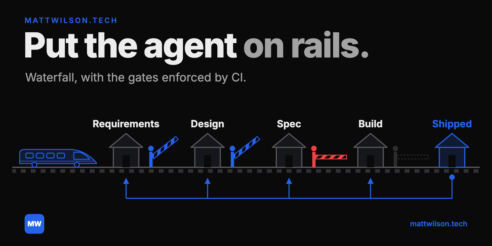
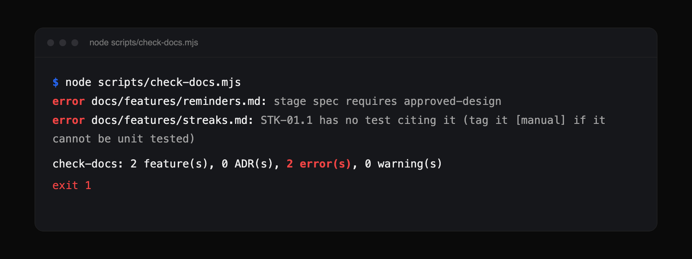

<p align="center"></p>

# Build on rails

[](https://github.com/mattwilson02/build-on-rails/actions/workflows/test.yml)
[](LICENSE)

A gated workflow for building software with AI agents, and the harness that enforces it.

The workflow comes from building a real app with Claude Code. The idea is old: waterfall. A product team approves each stage in order, and nothing downstream starts until it does. The new part is that agents do most of the typing, so the gates have to be mechanical, or they get talked around.

## What a harness is

A harness is **execution rules and tools for performing a task**. Rules say what the agent may and may not do. Tools make the rules checkable, or make the task possible. A prompt that says "please get approval first" is a wish. A script that fails the build when a feature's stage is ahead of its approvals is a rule with a tool behind it.

See [docs/harness.md](docs/harness.md).

## The workflow

```
requirements → design → spec → build → shipped
     ▲            ▲        ▲       │
     └────────────┴────────┴───────┘  work re-enters at the earliest stage that is wrong
```

- A feature is one file: requirements with testable criteria, design link, spec, approvals.
- The contributor, the person who owns the product, approves requirements, design and spec by setting a dated field. Merging the PR approves the build. The agent is forbidden to set an approval.
- Every criterion has a test that cites its ID. CI fails a shipped feature with an unproven criterion.
- Small changes take a fast lane. CI decides the lane from the PR title and diff, not from the author's say-so.
- Defects and new requirements go back to the stage whose document is wrong.

See [docs/gates.md](docs/gates.md). To see a feature go through it start to finish, read [docs/usage.md](docs/usage.md).

## What a failed gate looks like



CI runs the same check on every pull request, so neither of these can merge.

## What is here

| Path | What |
| ---- | ---- |
| [docs/usage.md](docs/usage.md) | Start here: the quick reference and one feature end to end |
| [docs/](docs) | The reasoning: the harness, the gates, how to adopt it |
| [kit/](kit) | Copy this into your repo: workflow docs, templates, scripts, CI, hooks, skills, `CLAUDE.md` |
| [examples/](examples) | A filled-in feature file |

The scripts need a current Node (developed on 24) and git. Nothing else. Run the kit's tests with `node --test kit/scripts/*.test.mjs`.

## If you are an agent

You were probably asked to adopt this or to work inside it. The short version:

1. Read [docs/usage.md](docs/usage.md). It is two screens.
2. Copy `kit/` into the target repo, including dotfiles: `cp -R kit/. /path/to/repo/`. Then follow [docs/adopting.md](docs/adopting.md).
3. Run `node scripts/status.mjs` for where things stand and `node scripts/check-docs.mjs` to check your work.

What it gives you: pass/fail criteria to build against, a script that says whether you are done, and a rule for when to stop and ask (code and an approved doc disagree). There is also [llms.txt](llms.txt).

## Status

Extracted from one project. It has run one builder with one approver, on a small app. How it holds up with a larger team is untested. The rules are opinionated; change them in `kit/docs/workflow.md` and the scripts follow.

## Licence

MIT.
